# 👋 Hi there, I'm Martijn

I'm a Software Developer with a strong passion for **Computer Science**, **Security**, **Automation**, and **Game Development**.

I enjoy building systems that are not just functional, but technically interesting. I like understanding how things work under the hood — and then pushing them further.

## 🚀 About Me

- 🎓 IT student
- 🔐 Interested in Information Security & Networking
- 🎮 Making games
- 🤖 Bot & automation development
- 🌐 Experienced with APIs, web scraping & data analysis
- 🧠 I enjoy designing systems with structure and scalability

**I love:** investigating how systems work internally · building tools · breaking systems (ethically 😉) · creating automation that saves time

## 🛠️ Tech Stack

## 📊 Stats

> Real numbers — private repositories included.

  

## 📈 Activity

  

<picture>
  <source media="(prefers-color-scheme: dark)" srcset="./profile/github-snake-dark.svg" />
  <source media="(prefers-color-scheme: light)" srcset="./profile/github-snake.svg" />
  
</picture>

## 📌 Featured Projects

| Project | Description | Tech |
|---|---|---|
| [Unbotling](https://github.com/MartijnW29/Unbotling) | Bot detection & automation research | Python |
| [VICTUZ study association app](https://github.com/MartijnW29/VICTUZ-studievereniging-app) | Full app for study association VICTUZ | C# |
| [SnapTime](https://github.com/MartijnW29/SnapTime) | Photo app | C# |
| [Tom-Armoede-Heerlen](https://github.com/MartijnW29/Tom-Armoede-Heerlen) | Website project tackling poverty in Heerlen | JavaScript |
| [Genshin Clicker](https://github.com/MartijnW29/genshin-clicker) | Browser clicker game | JavaScript |

*…and a lot more happening in private repos: automated content pipelines, Discord game bots, trading tools & more.*
